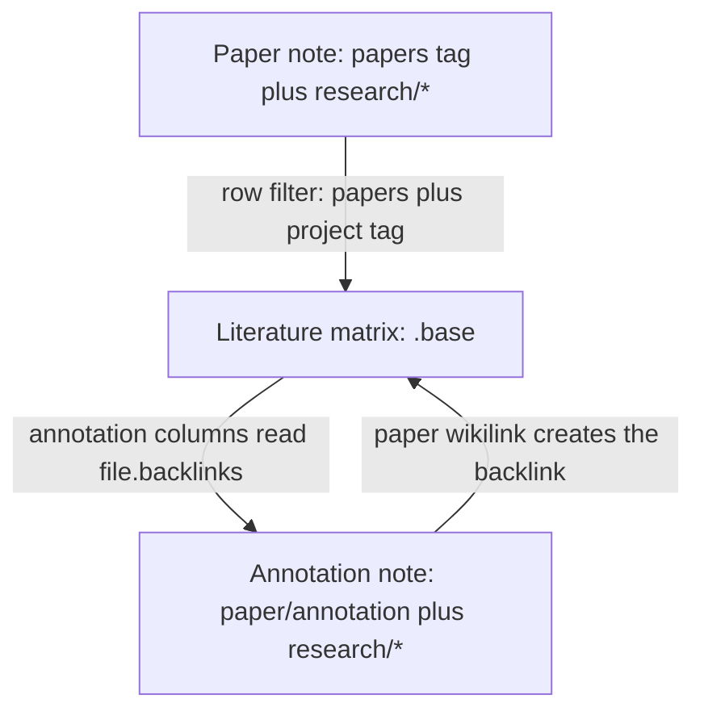

# Paper Workflow for Obsidian

A local Obsidian plugin for a research reading workflow. It writes the per-project annotation note for a paper, keeps each paper's `contribution` frontmatter field in sync with the note body, and generates the Bases view that reads annotation judgements back into the paper's row.

## Why this exists

A literature matrix in Obsidian is three note types pretending to be one table, and every hand-maintained edge between them fails silently.

- **The contribution is written twice.** You write it in the body as `**Contribution**: ...` because that is where you read it. Bases reads frontmatter, so you copy it into the `contribution` field as well, and flatten wikilinks and emphasis into plain text by hand.
- **A paper can serve several projects.** Each project needs its own judgement of the same paper, so there is one annotation note per paper-project pair. Bases has no join, so the matrix finds annotations through `file.backlinks`. That means each annotation needs the project tag and a `paper: "[[...]]"` link back to the paper. Get either wrong and two matrix columns go blank with no error.

This plugin does those two jobs and nothing else. It stays inside the vault, makes no network calls, and stores no state outside the notes and its own `data.json`.

## Prerequisites

| Requirement | Why |
| --- | --- |
| Obsidian 1.4 or newer | The floor declared in `manifest.json`. Annotation creation and the contribution sync work at that version. Developed and smoke tested on 1.12.7. |
| Obsidian 1.9 or newer, with the **Bases** core plugin enabled | Bases became available in Obsidian 1.9. The literature matrix is a `.base` file and renders nothing without it. Enable it in **Settings → Core plugins**. |
| `general_notes/` folder | Where the literature matrix is written. Nothing else is pinned to a folder, so paper and annotation notes can live anywhere. Created automatically if missing. |

Tags must be in a note's **frontmatter**, not inline in the body. The plugin reads frontmatter only.

## Installation

### From source

```sh
npm install
npm run build
```

`npm run build` writes `main.js`. `manifest.json` is already in the repo. Copy both into your vault's plugin folder:

```sh
mkdir -p /path/to/vault/.obsidian/plugins/paper-workflow
cp main.js manifest.json /path/to/vault/.obsidian/plugins/paper-workflow/
```

Then in Obsidian:

1. Settings → Community plugins → turn off Restricted Mode
2. Reload the app so the new plugin folder is picked up
3. Enable **Paper Workflow** in the installed plugins list

### Development workflow

`npm run dev` watches for changes and rebuilds on save. Symlink the two files into the vault so a rebuild needs no copy step:

```sh
cd /path/to/vault/.obsidian/plugins/paper-workflow
ln -sfn /path/to/this/repo/main.js main.js
ln -sfn /path/to/this/repo/manifest.json manifest.json
```

Reload the plugin after a rebuild with the Obsidian CLI:

```sh
obsidian vault=<vault-name> plugin:reload id=paper-workflow
obsidian vault=<vault-name> dev:errors
```

### Run tests

```sh
npm test            # single run
npm run test:watch  # watch mode
npm run typecheck   # type checking only
```

## User guide

### 1. Tag a paper note

A note is a paper note when its frontmatter `tags` list contains `papers`. Add the project tag too, one per project the paper serves:

```yaml
---
tags:
  - papers
  - research/undergrad_dissertation
date: 2026-10-01
link: https://arxiv.org/abs/2404.08763v4
pass: 2
---
# CATS: Contextually-Aware Thresholding for Sparsity in Large Language Models
**Contribution**: Proposes a framework & non-linear [[Activation Functions|activation function]] with the objective of [[Feed-Forward Neural Network (FFN)#Sparsity of FFN|sparsity]] activation of LLMs.
```

The only required pieces are the `papers` tag and a `**Contribution**:` line. The link, date, and pass fields belong to the matrix columns you choose to keep. If your vault has a `templates/` folder, the paper and annotation templates there already match this contract.

### 2. Tag a project

A project tag is any tag under the `research/` namespace, for example `research/undergrad_dissertation`. Put it in frontmatter on the notes that belong to the project. The plugin discovers projects from these tags, so nothing needs registering before first use.

The part after `research/` becomes the project's display title unless you register a nicer one in step 3. `research/undergrad_dissertation` resolves to `undergrad_dissertation`, which is why step 3 exists.

### 3. Register project titles

**Settings → Paper Workflow** lists your projects as editable rows. Add a row, type the tag and the title you want to see:

| Tag | Title |
| --- | --- |
| `research/undergrad_dissertation` | `Dissertation` |

The title names the annotation note, so `CATS` plus the title `Dissertation` gives `CATS - Dissertation.md`. Leave a row blank and it is ignored, so a half-typed row cannot break anything. The `research/` prefix is added for you when the field loses focus.

Registration is also what makes the picker in step 4 show a readable title instead of the raw tag.

### 4. Annotate a paper

Open a paper note and use either entry point:

- Run **Paper Workflow: Create paper annotation** from the command palette (`Cmd+P`).
- Right-click in the editor. The menu item only appears on paper notes.

A searchable picker opens listing every project, formatted as `Title (tag)` so you can search by either. Pick one and the plugin names the note `<Paper note name> - <Project title>.md` in the paper note's own folder, fills in frontmatter only with no body, and opens it:

```yaml
---
tags:
  - paper/annotation
  - research/undergrad_dissertation
date: 2026-11-07
paper: "[[CATS]]"
connection_to_own_research:
identified_gap:
---
```

The `paper` field is the backlink the matrix reads, so leave it alone. If the note already exists, the plugin opens it and says so instead of creating a second one, which is what keeps one annotation per paper-project pair.

Now write the two judgement fields. The matrix reads them straight from frontmatter:

| Field | What goes in it |
| --- | --- |
| `connection_to_own_research` | How this paper relates to your own work |
| `identified_gap` | What the paper leaves unresolved for your question |

Only the first annotation per paper-project pair reaches the matrix, because the lookup takes the first backlink match. Do not create a second one.

### 5. Let the contribution field fill itself

You never type the `contribution` frontmatter field. Write the contribution once, in the body, and the plugin copies it into frontmatter as plain text about a second after you save.

The sync only runs on notes tagged `papers`. It reads the first `**Contribution**:` line in the body and converts the value like this:

| In the body | In frontmatter |
| --- | --- |
| `[[Target\|Alias]]` | `Alias` |
| `[[Target]]` | `Target` |
| `[[Target#Heading]]` | `Target` |
| `[text](https://example.com)` | `text` |
| `**bold**`, `*italic*`, `_italic_`, `` `code` ``, `==mark==`, `~~struck~~` | `bold`, `italic`, `italic`, `code`, `mark`, `struck` |

Underscores inside a word are left alone, so `learning_rate` stays `learning_rate`, and a lone `~` or `=` survives. The frontmatter is rewritten only when the plain text actually differs, so saving a note without touching the contribution line does nothing.

Edit the line and the field follows. Delete the line and the field keeps its last value.

### 6. Build a literature matrix

Run **Paper Workflow: Create literature matrix** from the command palette. The wizard asks for three things:

| Field | Example | Notes |
| --- | --- | --- |
| Base file name | `Dissertation Literature Matrix` | `.base` is appended when missing |
| Research tag | `undergrad_dissertation` | `research/` prefix is added when missing |
| Project title | `Dissertation` | Recorded against the tag in settings |

The plugin writes `general_notes/<name>.base` and refuses to overwrite an existing one. It records the tag and title in settings only when the tag is new, so an existing project keeps the title you already chose.

The generated view is a wrapping table with an empty sort and one row per paper of that project. Columns:

| Column | Source |
| --- | --- |
| File name | Paper note name |
| Pass | Paper frontmatter `pass` |
| Contribution (Purpose, Method, Implications) | Paper frontmatter `contribution`, kept current in step 5 |
| Notable Experimentation Approaches | Paper frontmatter `notable_experimentation_approaches` |
| Connection to Own Research | The annotation's `connection_to_own_research` |
| Identified Gap | The annotation's `identified_gap` |
| Annotation | A link to the annotation note |
| Link | Paper frontmatter `link` |

### 7. Read the matrix

Open the `.base` file. A paper row shows blank judgement columns for any of these reasons, in order of likelihood:

1. No annotation note exists for that paper-project pair.
2. The annotation's `paper` field does not name the paper note exactly.
3. The annotation is missing one of its two tags, or carries the wrong project tag.
4. Obsidian has not indexed the new annotation yet. Give it a moment.

One matrix covers one project. A second project needs a second matrix, generated with that project's tag.

## How it works



Bases has no join and no rollup, so a paper row cannot read another note's frontmatter directly. The one hook is `file.backlinks`, which lists the notes linking to the row's note. The generated matrix uses it to filter backlinks down to annotation notes carrying the same project tag, then reads `connection_to_own_research` and `identified_gap` from the first match.

That is why the annotation's `paper` field matters and why the plugin writes it as a wikilink. A frontmatter wikilink counts as a link, so the annotation needs no body.

The contribution sync listens for vault modify events, debounces per file path, and compares the converted body value against cached frontmatter before writing. An unchanged value never triggers a write, and that compare is what stops a write loop. A path is also held in a guard set while the plugin's own write is in flight, so the modify event caused by that write is ignored.

## Settings

| Setting | Default | Description |
| --- | --- | --- |
| Research projects | empty | Rows of tag and title. Titles name the annotation notes. |

Stored in `.obsidian/plugins/paper-workflow/data.json` as `{ "projects": [{ "tag": "...", "title": "..." }] }`.

## What it does not do

No BibTeX handling, no arXiv metadata fetch, no in-note buttons or editor widgets, no sync for `notable_experimentation_approaches`, and no paper note creation. It stays local and is not published.

Two rough edges worth knowing:

- A project title containing `/` produces an invalid note path, and the failure shows up as an error notice.
- Emptying the `**Contribution**:` line leaves the last frontmatter value in place rather than clearing it.
